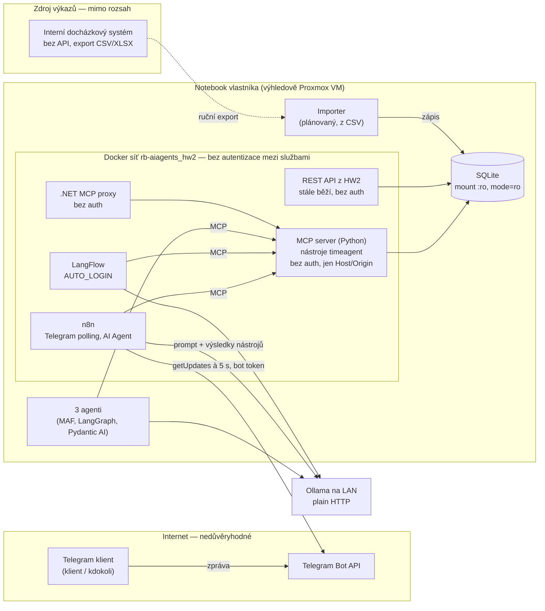

# 1. Kontext a architektura

[← Rozcestník](README.md)

## 1.1 Účel a scénář

timeagent odpovídá na otázky nad výkazy práce pro klienty. Například:
„kolik hodin jsme odpracovali v září“, „podklad k faktuře za projekt X“
nebo „kolik zbývá do kapacity“. Výsledky počítají deterministické nástroje,
model jen vybírá nástroj a formuluje odpověď.

**Vymezený scénář:** kontaktní osoba klienta napíše botu do Telegramu
v soukromém chatu a dostane hodiny a fakturační podklad **jen za projekty
svého klienta**. Vlastník (dodavatel) bot používá dál bez omezení, ze svého
Telegram účtu.

## 1.2 Uživatelé, identity a aktiva

| Identita | Kdo | Jak se dnes prokazuje |
|---|---|---|
| Vlastník | dodavatel, provozovatel systému | nijak, systém běží na jeho notebooku; v Telegramu nijak, bot odpoví komukoli |
| Klient (plánováno) | kontaktní osoba klienta v Telegramu | **nijak**, bot odpoví komukoli, i ve skupině |
| Služby | n8n, LangFlow, 3 agenti (MAF, LangGraph, Pydantic AI), .NET MCP proxy | nijak, MCP je bez autentizace |
| Model | lokální Ollama (`qwen2.5:32b`) na LAN | není identita, volá nástroje za uživatele |

| Aktivum | Proč je cenné |
|---|---|
| Hodiny podle klienta a projektu | obchodní informace; klient nemá vidět vytížení pro jiné klienty |
| Hodinové sazby | obchodní tajemství, každý klient má jinou |
| Popisy výkazů | volný text; obsahuje názvy ticketů a interní věci klienta, případně jména osob (osobní údaje) |
| Fakturační podklad | podklad pro peníze, musí být správný a patřit správnému klientovi |
| Telegram bot token, hesla n8n a LangFlow | převzetí bota = vydávání se za dodavatele a čtení všech dat |

## 1.3 Komponenty a datové toky

**Trust boundaries:**

| # | Hranice | Co ji překračuje |
|---|---|---|
| B1 | Internet → n8n (Telegram) | text zprávy a `chat.id` od kohokoli, kdo bota najde |
| B2 | model → nástroje | argumenty nástrojů (projekt, období), které určuje model podle nedůvěryhodného textu |
| B3 | služby v síti → MCP | jakékoli volání nástroje, bez prokázání identity |
| B4 | zdroj výkazů → databáze | popisy výkazů jako volný text, později se dostanou do kontextu modelu |
| B5 | hostitel → model | prompt a výsledky nástrojů včetně popisů a sazeb, přes LAN bez šifrování |

## 1.4 Co je fakt, co předpoklad, co mimo rozsah

**Fakta ověřená v kódu**

| Oblast | Stav | Kde |
|---|---|---|
| Nástroje | 5 nástrojů, jen čtení, parametrizované SQL | `HW1/src/timeagent/tools.py` |
| Databáze | otevřená `mode=ro`, v kontejneru mount `:ro` | `db.py`, compose |
| MCP server | volá `tools.call_tool` beze změny, žádná kontrola volajícího | `HW3/mcp/src/timeagent_mcp/server.py` |
| **Identita v nástrojích** | **žádná**, projekt je volitelný argument od modelu | `tools.py` |
| Únik bez projektu | `query_time_entries` a `summarize_by` bez projektu sečtou všechny klienty | `tools.py:135`, `:211` |
| Únik přes dimenzi | `summarize_by(dimension="client")` rozepíše hodiny podle klientů | `tools.py:211` |
| Únik přes kapacitu | `capacity_check` projekt nebere, vrací celkový objem | `tools.py:323` |
| Únik přes seznam | `list_projects` vrátí všechny projekty, klienty a sazby; prompt ho modelu doporučuje volat jako první | `tools.py:125-132` |
| Únik přes chybu | neznámý projekt → hláška vypíše všechny projekty a klienty | `tools.py:78-83` |
| Únik přes nejednoznačnost | částečná shoda názvu → hláška vypíše odpovídající projekty, i cizí | `tools.py:84-89` |
| Únik přes prázdný výsledek | poznámka `note` uvádí rozsah dat přes všechny klienty; prompt ji modelu velí zopakovat | `tools.py:99-118` |
| Telegram | bere `text` a `chat.id` od kohokoli, žádný allowlist | `HW2/scripts/build_n8n_workflow.py:77-91` |
| Autentizace služeb | žádná: oba MCP servery, REST API, chat webhook n8n (`public: true`) | compose, workflow |
| Ochrana MCP | jen kontrola Host/Origin (proti DNS rebindingu, ne proti volajícímu) | `server.py` |
| Administrace | LangFlow `AUTO_LOGIN=true`; n8n `N8N_BLOCK_ENV_ACCESS_IN_NODE=false`; výchozí heslo n8n v `.env.example` | `HW2/docker-compose.yml`, `HW2/.env.example` |
| Síť | porty publikované jen na loopback, uvnitř sítě vše na `0.0.0.0` | compose |
| Model | Ollama přes `OLLAMA_BASE_URL`, výchozí LAN po plain HTTP | `.env`, agenti |
| Logy | audit chybí; n8n drží historii běhů bez retence | — |
| Systémový prompt | pravidla proti vymýšlení čísel, nic proti injection ani k důvěrnosti; společný pro agenty HW3 | `HW3/agents/system_prompt.json` (generovaný z `HW1/src/timeagent/agent.py`) |
| Testy | 106 + 7 + 6, žádný bezpečnostní | — |

**Fakta z provozu**

- Běží jen lokálně na notebooku vlastníka.
- Telegram bot reálně běžel v HW2, teď neběží.
- V databázi je jen syntetický seed s fiktivními klienty.
- Výkazy se vedou v interním docházkovém systému. API nemá, umí export
  CSV/XLSX, i podle zákazníka a s příznakem fakturovatelnosti.
- Clockify se nepoužívá, importer z něj je historický.

**Předpoklady rozšíření**

- Bot používají kontaktní osoby klientů, jeden klient může mít víc lidí
  (víc `chat_id`).
- **Oprávnění má klient (firma), ne osoba.** Všechny kontaktní osoby téhož
  klienta vidí totéž. Vědomé rozhodnutí: podklad k faktuře patří firmě
  a klienti dnes nemají projekty, které by před vlastními lidmi skrývali.
  Kdyby to přestalo platit, politika musí mapovat `chat_id` na projekty, ne
  na klienta.
- Bot se používá **jen v soukromém chatu**. Ve skupině je `chat.id` id
  skupiny, ne člověka, a identita by se tak sdílela se všemi členy.
- Vlastník má vlastní `chat_id` v politice (`owner_chat_ids`).
- Vazbu `chat_id → klient` spravuje vlastník ručně. Nové `chat_id` přidá až
  po ověření s klientem jiným kanálem (e-mail, telefon), ne podle toho, co
  člověk napíše botovi.
- Klient vidí hodiny, popisy, fakturační podklad a sazbu **jen svých projektů**.
- Data se do DB dostávají periodickým importem exportu CSV. Přesný formát
  exportu zatím neznám.
- Výhledově běh na Proxmox VM v domácí síti.

**Mimo rozsah**

- HW1 jako aplikace (CLI, LiteLLM, cloudové modely).
- Docházkový systém a jeho plnění přes prohlížeč.
- Další zdroje výkazů (ClickUp, Redmine, Jira), plánované jako importery se
  stejným vzorem.
- Bezpečnost Telegramu a Ollamy jako produktů, fyzická bezpečnost notebooku.
- Zápisové akce: nástroje jsou read-only a v tomto scénáři zůstanou.
